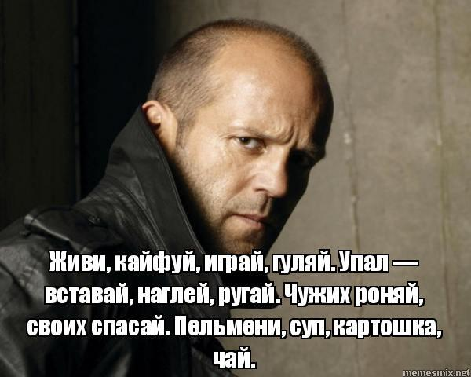

# Лабораторная работа №1

- ФИО: Коршиков Егор Андреевич
- Группа: 6402-010302D
- Руководитель: Савельев Дмитрий Андреевич
- Тема: Исследование методов асимметричного поиска информации с применением языковых моделей

Сдаются только слабаки. И анализы (с) Джейсон Стетхем



# Лабораторная работа №2

Тема: многостраничный сайт на HTML и CSS по мотивам сайта Самарского университета (ssau.ru).

Страницы лежат в папке `lab2`:
- `index.html` - главная с новостями
- `institutes.html` - институты и факультеты
- `schedule.html` - расписание группы
- `contacts.html` - контакты
- `style.css` - стили

Что выполнено по заданию:
- Страниц: 4 (нужно от 3 до 5)
- Блочные элементы: `div`, `h1`-`h3`, `p`, `ul`, `li`, `table`; строчные: `a`, `span`, `b`, `i`, `img`, `br`
- Ссылки: 96 (меню, новости, институты, ссылки на ssau.ru, `mailto:`)
- Картинки: 36 (логотипы, баннер, фото новостей и институтов, карта)
- Таблица: 1 (расписание группы на неделю)
- CSS в отдельном файле `style.css`, подключён ко всем страницам
- Виды селекторов: 7 (по тегу, по классу, по id, потомка, тег + класс, псевдокласс `:hover`, псевдоэлемент `::after`)
- Цвет: палитра как на ssau.ru (синий, тёмно-синий, оранжевый, серый) и цвета типов занятий
- Выравнивание в таблице: по левому краю, по центру и по правому краю
- JS, Bootstrap и другие библиотеки не используются

# Лабораторная работа №3

Тема: основы JavaScript. Каркас проекта взят из репозитория [teach-kirshdv/js-tasks](https://github.com/teach-kirshdv/js-tasks) и лежит в папке `lab3`.

Задания находятся в `lab3/src/core.js`, тесты в `lab3/src/core.spec.js`.

Запуск тестов:
```
cd lab3
npm install
npm test
```

Что реализовано:
- `isInteger` - проверка на целое число через побитовое ИЛИ
- `even` - массив чётных чисел от 2 до 20
- `sumTo` - сумма чисел до n циклом
- `recSumTo` - сумма чисел до n рекурсией
- `factorial` - факториал
- `isBinary` - проверка, является ли число степенью двойки (через `n & (n - 1)`)
- `fibonacci` - n-е число Фибоначчи
- `getOperationFn` - функция, которая запоминает значение и применяет к нему операцию (замыкание)
- `sequence` - генератор арифметической последовательности (замыкание)
- `deepEqual` - глубокое сравнение объектов рекурсией

Все 16 тестов проходят.
